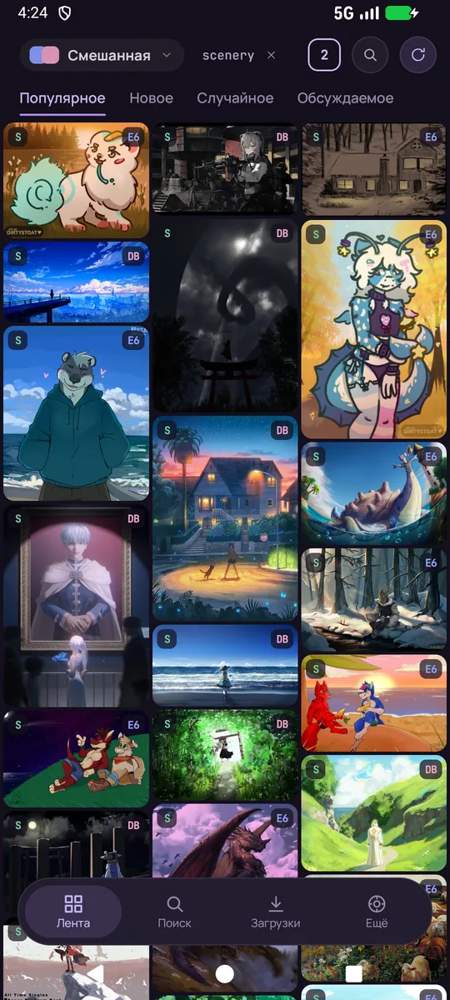
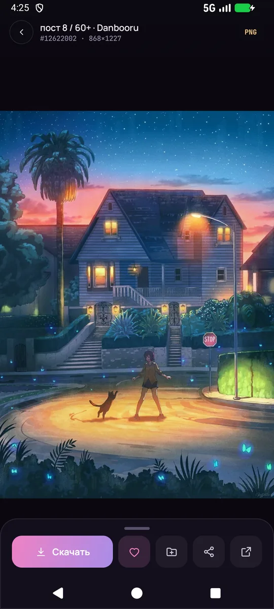
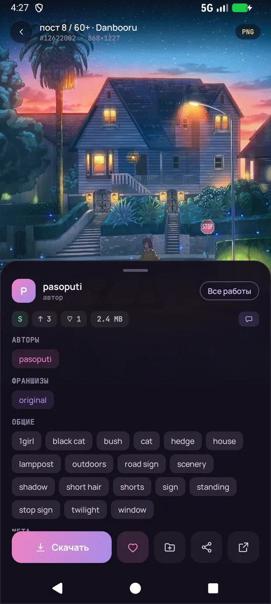
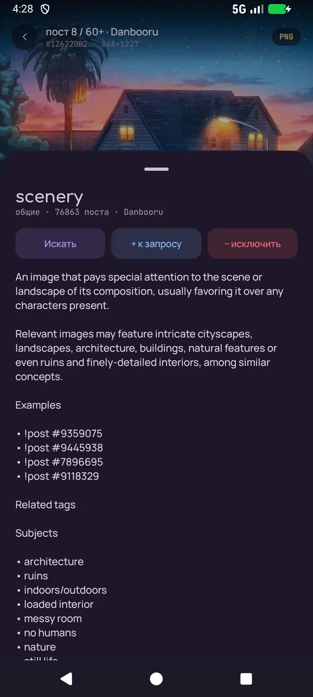
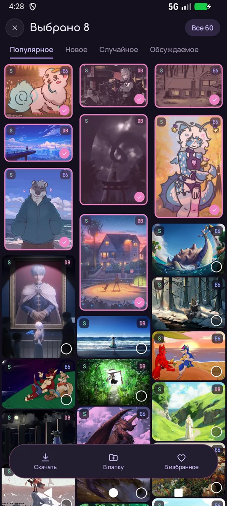
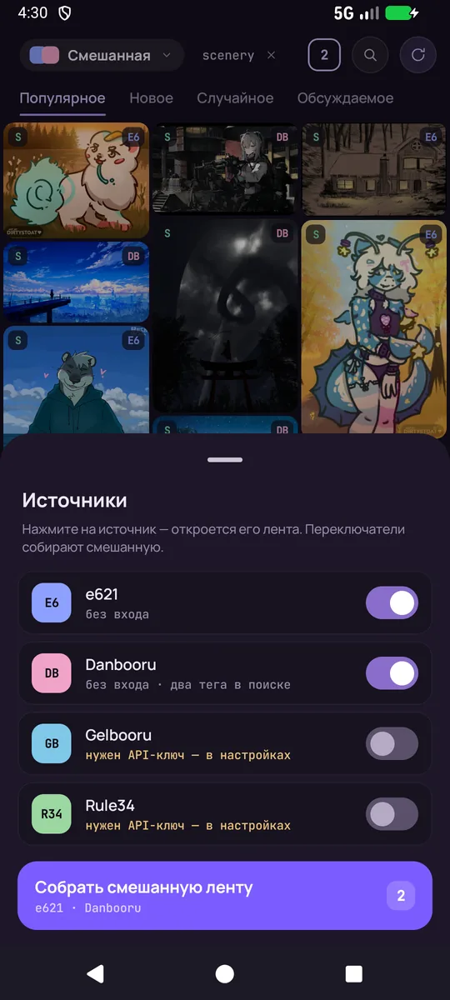
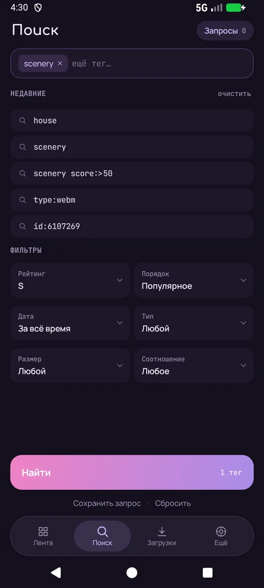

# BooruHub

Четыре бору в одном кармане: e621, Danbooru, Gelbooru и Rule34. Можно смотреть по одному, а можно смешать в общую ленту.

<p align="center">
  
  
  
</p>

*English: an Android client for e621, Danbooru, Gelbooru and Rule34. The interface is Russian only for now. Build steps and the license are below and need no translation.*

> **18+.** На этих сайтах полно контента для взрослых. Приложение показывает только то, что вы у них запросили, а в настройках есть фильтр по рейтингу. Скриншоты сняты с одним Safe.

## Откуда взялось

Обычно выходит так: под e621 одно приложение, под Danbooru другое, Gelbooru открывается в браузере, и у каждого сайта свой синтаксис поиска. Надоело.

Здесь запрос пишется один раз, в стиле e621: `rating:s`, `order:score`, `-tag`, `~a ~b`. Под каждый сайт его переводит само приложение. Смешанная лента спрашивает все сайты одновременно, а если какой-то задумался, ждёт его не дольше шести секунд и показывает то, что успело прийти.

## Что умеет

**Лента и поиск**
- Вкладки, как в браузере, и у каждой свой набор сайтов. Между ними можно листать свайпом по строке запроса.
- Сохранённые запросы. Примерно раз в час приложение проверяет их и присылает уведомление, если появилось новое.
- «Лучшее» за день, неделю или месяц на e621 и Danbooru.

**Просмотр**
- Зум щипком и двойным тапом. В видео двойной тап по краю перематывает на 5, 10 или 15 секунд (шаг выбирается в настройках), каждый следующий тап добавляет ещё столько же.
- Ноты с переводом прямо поверх картинки, пулы с кнопкой «читать дальше», родительские и дочерние посты, комментарии.
- Долгое нажатие на тег открывает его вики. Можно наконец выяснить, что значит `blep`.

**Своё**
- Избранное e621 и Danbooru подтягивается из аккаунта. Gelbooru и Rule34 через API сердечки ставить не дают, поэтому их лайки хранятся в приложении.
- Коллекции на телефоне и сеты e621.
- Зажмите плитку и, не отпуская, проведите пальцем: выделится сразу пачка. Её можно скачать, сложить в папку или отправить в избранное.
- Чёрный список (по желанию синхронизируется с e621) и загрузки в фоне.
- Резервная копия одним JSON-файлом: настройки, вкладки, запросы, коллекции, лайки. API-ключи попадут туда, только если сами включите.

<p align="center">
  
  
  
  
</p>

## Установка

APK лежит в [Releases](../../releases). Нужен Android 10 или новее, процессор arm64 (почти любой телефон последних лет).

Gelbooru и Rule34 без API-ключа не отвечают. Ключ бесплатный: он есть в настройках вашего аккаунта на сайте, а в приложение вставляется в «Настройки → Другие источники». e621 и Danbooru работают и без входа. Вход нужен для избранного, а Danbooru без аккаунта пускает в поиск только два тега.

## Сборка

Интерфейс написан на Jetpack Compose. Под ним ядро на Rust: оно ходит в API сайтов, переводит запросы, разбирается с чёрным списком и хранит данные. Ядро живёт в `crates/core`, к Android его подключает `crates/android` через JNI.

Понадобятся:

- JDK 17
- Android SDK с платформой 37 и NDK `29.0.14206865`
- Rust 1.88+ с таргетом `aarch64-linux-android` (для эмулятора ещё `x86_64-linux-android`)

```sh
cd android
./gradlew assembleRelease              # для телефона
./gradlew assembleRelease -Pemulator   # плюс x86_64 для эмулятора
```

Готовый APK появится в `android/app/build/outputs/apk/release/`. Если нет файла `android/keystore.properties`, сборка подписывается отладочным ключом. Такой APK запустится, но поверх версии из Releases не встанет: Android откажется ставить приложение с другой подписью.

Тесты ядра: `cargo test -p booruhub-core`.

## Лицензия

[GPL-3.0-or-later](LICENSE) с одним дополнительным условием по пункту 7(b): в любой распространяемой версии должна остаться строка об авторе в разделе «О программе». Подробности в [NOTICE](NOTICE).

С e621, Danbooru, Gelbooru и Rule34 проект никак не связан, просто им пользуется.
